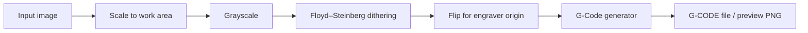
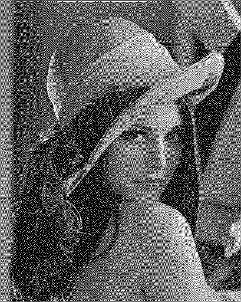

# Image2GCode

<div align="center">

**Convert raster images into laser‑engraving G‑Code for a modified Creality Ender‑3**

[](#)
[](#)
[](#)
[](LICENSE)

</div>

## 📖 Overview

**Image2GCode** is a C++ command-line tool that turns a raster image (JPG, PNG, …)
into **G-Code for a laser engraver** without any CNC software in between.

The pipeline is fully self-contained:



For every dark (dithered) pixel, the tool emits a short **laser pulse command**
(`M106 S255` → dwell → power reduction). The result is a list of `G00` moves and
pulses that reproduces the image as a **dot-matrix engraving** on your machine.

## ✨ Features

- **Pure C++ / OpenCV** — small, dependency-light, easy to build.
- **Floyd–Steinberg error-diffusion dithering** — converts grayscale images into
  binary dot patterns that keep the original shading.
- **Automatic aspect-ratio handling** — scales the image to fit your work area
  without distortion.
- **Command-line configuration** — set the work area, beam diameter, and origin.
- **Dual output** — writes both the G-Code file *and* a preview PNG of the
  dithered pattern, so you can check the result before burning anything.
- **Customizable laser tuning** — burn/dwell timing constants live in a single
  spot at the top of `main.cpp`.

## 🛠️ Hardware: the Ender‑3 laser mod

This project was written for a **custom laser modification of a Creality Ender‑3
3D printer**:

- The **laser module is attached to the printer's hot-end fan port**.
- The fan port is controlled with **`M106`** (fan speed), so the firmware sees the
  laser as a fan:
  - `M106 S255` → **laser ON** at full power
  - `M106 S10`  → laser ON at ~4% power (idle / very low energy)
  - `M107` → fan/laser **OFF**
- The G-Code header also disables the layer fan with `M107` and activates the
  lasered tool with `M03`, and ends with `M05 S0` ("deactivate laser").
- The machine toolpaths are written in **absolute coordinates (`G90`)** and
  **metric units (`G21`)**.

> 💡 This is why the generated code uses fan commands (`M106`/`M107`) to drive
> the laser — if your controller maps the laser differently (e.g. `M03`/`M04`
> spindle speed), adapt the header/tail strings in `main.cpp`.

## 🛠️ Requirements

- **CMake ≥ 3.5** (or `g++` directly, see below)
- **OpenCV 4.x / 5.x** (`core`, `imgproc`, `highgui`, `imgcodecs`)

### Linux (Debian/Ubuntu)

```bash
sudo apt install cmake g++ libopencv-dev
```

## 🏗️ Compiling

> Prefer the CMake route — start from the repository root:

```bash
cmake -S image2gcodeCpp -B build
cmake --build build -j
```

Alternatively, build in place from inside the `image2gcodeCpp/` folder:

```bash
cd image2gcodeCpp
cmake .
make
```

A `compile.sh` script is also provided for a direct `g++` build:

```bash
cd image2gcodeCpp
chmod +x compile.sh
./compile.sh
```

The executable is named `image2gcodeOpenvcCpp` (CMake) or `a.out` (script).

## 🚀 Usage

```bash
./build/image2gcodeOpenvcCpp <image> [options]
```

| Option | Description | Example |
|--------|-------------|---------|
| `--beamWidth <mm>` | Beam/dot diameter used as the pixel pitch (`0` disables spacing) | `0.1` |
| `--x0`, `--y0` | Origin of the engraving area in millimeters | `0`, `0` |
| `--wf <mm>` | Width of the physical work area | `50` |
| `--hf <mm>` | Height of the physical work area | `50` |
| `--output_file_img <path>` | Write a preview of the dithered pattern (PNG/JPG) | `dithered.png` |
| `--output_gcode <path>` | Write the generated G-Code file | `out.gcode` |

### Example

```bash
./build/image2gcodeOpenvcCpp image2gcodeCpp/lenna.jpg \
    --beamWidth 0.1 --wf 100 --hf 100 --x0 10 --y0 10 \
    --output_file_img preview.png --output_gcode output.gcode
```

> 💡 `--wf` / `--hf` define the target work area, while `--beamWidth`
> sets the dot pitch — the image is scaled (keeping the aspect ratio) until it
> fits inside `wf × hf`.

## 🔬 How it works

1. **Load & scale** — the image is read with OpenCV and resized (cubic
   interpolation) so it fits the requested work area while preserving its
   aspect ratio.

2. **Grayscale & dither** — the image is converted to gray and normalized to
   `[0, 1]`. A **Floyd–Steinberg error-diffusion** step then converts it to a
   binary (black/white) pattern, distributing the quantization error to the
   neighboring pixels (`7/16`, `3/16`, `5/16`, `1/16`) to preserve shading.

   <p align="center">
     
     
     
   </p>
   <p align="center"><em>Left to right: original → grayscale → dithered (the pattern sent to the laser).</em></p>

   **What is dithering?** A laser engraver can only burn *or not burn* each dot —
   it has no "half gray". Dithering solves this by **distributing the error**:
   when a pixel is forced to black or white, the difference (the *error*) is
   spread to its neighbors. Dark areas become dense clusters of dots, light
   areas stay nearly empty — and from a distance the eye averages the dots back
   into the original shading, so gradients survive without a variable-power
   laser. The implementation in `main.cpp` uses the classic
   Floyd–Steinberg weights (`7/16` east, `5/16` south, `3/16` south-west,
   `1/16` south-east).

3. **Flip** — the pattern is flipped vertically so the engraving coordinates
   match the machine origin.

4. **G-Code emission** — for every black pixel the tool generates:

   ```gcode
   G00 X<x> Y<y> F3000.0   ; rapid move to the dot position
   M106 S255 F3000.0       ; laser ON at full power
   G4 P65                  ; dwell (burn time, ms)
   M106 S10 F3000.0        ; laser ON at low power (idle)
   G4 P80                  ; dwell (cool-down, ms)
   ```

   The file is framed with a standard header (`G90` absolute, `G21` metric,
   laser warm-up) and tail (`M05` laser off, `M02` program end).

> ⚠️ **Dithering portability:** the dither loop reads rows `1 … rows-1` while
> propagating error to `j+1`, so the last row and the first/last columns are
> only partially processed. Results look good in practice, but this is a
> known edge case.

## 🧭 Roadmap

- [ ] Proper CLI parsing (use `getopt` / a micro argument-parser instead of manual scanning)
- [ ] Contour/vector engraving strategies (lines, hatch, spiral) in addition to dot-matrix
- [ ] User-tunable laser power, feed rate, and dwell times via command-line flags
- [ ] Bar-style looping (serpentine scanning) to reduce rapid moves
- [ ] Unit tests for the dithering and G-Code generation logic

## ⚖️ License

Distributed under the **MIT License**. See [`LICENSE`](LICENSE) for more information.
